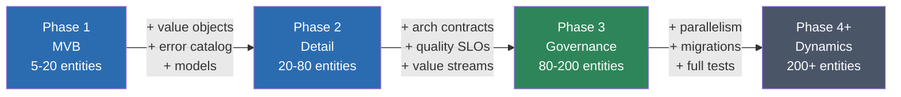

# Modeling approaches

Start with a Minimal Viable Blueprint for a new system. For an existing system, start by
reading the code. Grow either model in phases.

## Usage modes

### Greenfield

Start with a Minimal Viable Blueprint (MVB).

1. Identify bounded contexts and aggregate roots.
2. Model the primary command-to-event causal chains.
3. Add rules, stories, and test cases for the happy path.
4. Add value objects, error paths, governance, and quality as the model grows.

Start with 5-20 entities, validate, then grow through the phases below. The [Modeling
Guide](modeling-guide.md) covers phases, decision trees, and anti-patterns.

For workshops, business contributors, and AI handoff, use the non-technical
[Blueprint Handoff Atlas](handoff-guides/markdown/README.md) and its
[umbrella PDF](handoff-guides/pdf/blueprint-handoff-atlas.pdf).

### Brownfield

Model an existing system from evidence in the code.

1. Enumerate domain aggregates from code directories.
2. Assign DDD roles (aggregate root, entity, value object) from behavioral signals.
3. Group CRUD variants into semantic operations.
4. Model the structure and link entities to the source via `code_refs`.

Code is the source of truth for the Design Plane of an existing system. Specs describe intent.
See the [full Phase 0 protocol](modeling-guide.md#phase-0---knowledge-analysis-existing-systems-only).

### Iterative modeling

Each phase has entrance criteria and reports which generators can produce useful output from
the current model, including OpenAPI, AsyncAPI, PRD, and Event Storming.

| Phase | Focus | Entity count |
| --- | --- | --- |
| 1 | MVB with aggregate roots, key commands and events, and one story per context | 5-20 |
| 2 | Detail with value objects, an error catalog, models, decisions, and questions | 20-80 |
| 3 | Governance with architecture, quality (SLOs), UI, organization, value streams, and milestones | 80-200 |
| 4+ | Dynamics with parallelism, race conditions, migrations, and full test coverage | 200+ |

### Knowledge gathering

| Model element | Use |
| --- | --- |
| Questions (`QN001`) | Record what a domain slice should explain. Unanswered questions (`answered_by: []`) expose gaps for backlog prioritization. |
| Inquiries (`INQ001`) | Capture temporary governance concerns during analysis. |
| Evidence chains | Link goals, risks, and decisions to supporting data. |

## Best practices

1. **Start with a Minimal Viable Blueprint.** Capture intent, validate a small model, and
   iterate. A coherent 15-entity model is a better start than a tangled 200-entity model.
2. **Use small files.** The loader merges files of the same schema type within a slice.
   Seven 100-line files can make the structure easier to read than one 700-line file.
3. **Give each fact one authoritative location.** Causal links live in `domain.yaml`
   (`produces` and `reacts_to`). Story steps provide a convenient view checked against those links.
4. **Use business language for operations.** Put technical names in `code_refs` to bridge the
   model and implementation.
5. **Record deferred work and why it can wait.** Add quality metrics, UI screens, and
   organizational hierarchy in Phase 3, once the domain skeleton is stable.
6. **Document emerging conventions.** Use validator warnings before making a convention a
   hard schema constraint.

See the [Modeling Guide](modeling-guide.md) for more practices, anti-patterns, decision trees,
and reference direction rules. See [File Conventions](file-conventions.md) for naming, IDs,
and directory layout.
