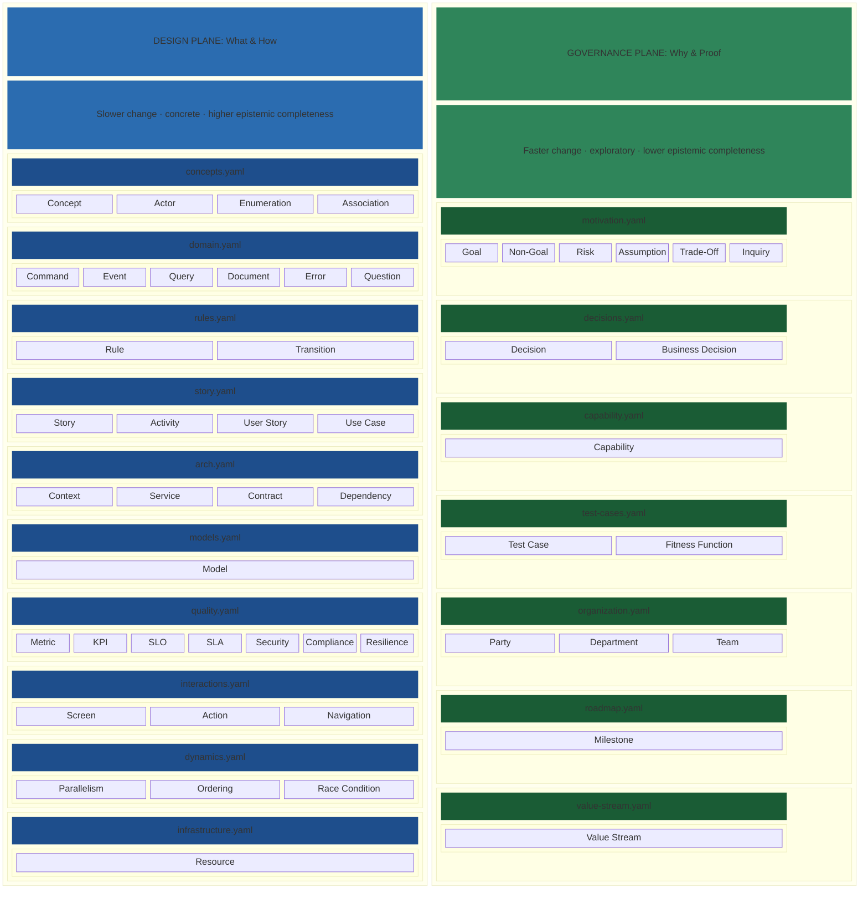

# Architecture

A blueprint is a single formal model of what a digital system does, why it exists, and how
those claims are proven. Archally Blueprint Schema captures domain design, business rules,
value streams, governance, and organizational alignment in a machine-readable YAML format.
You can combine modeling methods in the same specification.

## The problem

Architecture knowledge spreads across wikis, slides, whiteboard photos, Confluence pages,
and team memory. When a team needs to split a service, add a context, or evaluate a migration,
it can spend days reconstructing that knowledge. Documentation can drift from code within
weeks, and new team members can spend months piecing together how the system works.

## System cartography

Archally surveys the system, maps it at several scales, and records gaps in the map.

| Cartography | Blueprint equivalent |
| --- | --- |
| Map layers (topographic, political, transport) | The Design Plane and Governance Plane show different concerns over the same bounded context. |
| Legend and symbols | The metamodel defines typed IDs such as `CN001`, `CMD001`, and `EVT001`. Humans can learn the notation and tools can read it. |
| Survey and triangulation | Evidence chains and cross-layer validation let readers check claims against supporting facts. |
| Uncharted territory | Unanswered questions such as `QN001` with `answered_by: []` record what remains unknown. |
| Scale | Abstraction levels range from system context to individual operations and rules. |
| Hazard markers | Governance artifacts surface risks, pending migrations, and unresolved decisions. |

## Design and governance

The **Design Plane** records vocabulary, aggregates, commands, events, queries, business rules,
data models, stories, UI screens, and quality attributes. It captures established knowledge
that changes deliberately.

The **Governance Plane** records goals, risks, assumptions, decisions, test cases, capabilities,
value streams, milestones, and organizational ownership. It captures evolving knowledge.
Evidence chains use `discovery_stage`, `certainty`, and `evidence[]` to trace a governance
entity from hypothesis to confirmation.

The **metamodel** provides a common vocabulary and traceability across both planes, including
typed IDs, versioning, evidence chains, ownership, and code references.

## One model, many outputs

OpenAPI specifications, AsyncAPI contracts, PRDs, Event Storming boards, capability maps,
and context diagrams can all come from the same blueprint. Regenerate them from the source
model to keep contracts, documentation, diagrams, and onboarding materials consistent.

## Built for humans and AI agents

Every schema field has a machine-readable `description`. A team member can read the blueprint
to learn the system. Archally Pro MCP servers give agents deterministic graph queries over the
validated model, with typed entities, traced relationships, and governance constraints available
at inference time. See [Archally Pro](tools.md#archally-pro).

## Local-first and version-controlled

Keep the plain YAML files in your Git repository. The model can contain bounded contexts,
business rules, competitive decisions, and organizational structure without requiring a cloud
upload, a vendor platform, or additional infrastructure. Validate locally, review in pull
requests, and deploy through your existing workflow.

## Schema files

| Layer | Schema | Entity types |
| --- | --- | --- |
| Cross-cutting | `metamodel.schema.yaml` | Typed ID patterns, versioning, shared definitions |
| Cross-cutting | `migration.schema.yaml` | Model evolution: entity, property, relationship, meta changes |
| Design | `domain.schema.yaml` | Commands (CMD), Events (EVT), Queries (QRY), Documents (DOC), Errors (ERR), Questions (QN) |
| Design | `concepts.schema.yaml` | Concepts (CN), Actors (ACT), Enumerations (EN), Associations (AS) |
| Design | `rules.schema.yaml` | Rules (SR/CR/DR/EQ/VR), Transitions (TR) |
| Design | `arch.schema.yaml` | Parties, Contexts, Services, Contracts, Dependencies |
| Design | `models.schema.yaml` | Data models (MDL) with OpenAPI/AsyncAPI-compatible schemas |
| Design | `story.schema.yaml` | Stories (STR), Activities (SA), User Stories (US), Use Cases (UC) |
| Design | `quality.schema.yaml` | Metrics (MT), KPIs (KPI), SLOs (SLO), SLAs (SLA), Security (SEC) |
| Design | `interactions.schema.yaml` | Screens (SCR), Actions (UAC), Navigation (UNV) |
| Design | `dynamics.schema.yaml` | Parallelism (PAR), Ordering (ORD), Race Conditions (RC) |
| Design | `infrastructure.schema.yaml` | Resources (IR), Environments (ENV), Resource Types (RT), Bindings (BND), Deployment Scopes (DSC) with TOSCA relations and IaC refs. `scope_ref` (who owns or pays for it) and `hosted_on` (what it runs on) are independent. |
| Governance | `motivation.schema.yaml` | Vision, Goals (G), Non-goals (NG), Risks (R), Assumptions (A), Trade-offs (T) |
| Governance | `decisions.schema.yaml` | Decisions (D), Business Decisions (BD) |
| Governance | `capability.schema.yaml` | Capabilities (CAP) |
| Governance | `test-cases.schema.yaml` | Test cases (TC/EC/ER), Fitness functions (FF) |
| Governance | `organization.schema.yaml` | Parties (PRT), Departments (DPT), Teams (TM) |
| Governance | `roadmap.schema.yaml` | Milestones (MS) |
| Governance | `value-stream.schema.yaml` | Value Streams (VS) |

| Reference | What it covers |
| --- | --- |
| [Schema Reference](schema-reference.md) | Full ID patterns, traceability map, and schema evolution. |
| [File Conventions](file-conventions.md) | File naming and layout rules. |
| [Schemas by version](../schema/) | Each version has its own README index for Design, Governance, and the cross-cutting metamodel and migration schemas. |
| [Blueprint Schema Atlas](schema-atlas/) | A human-readable layer map, entity catalog, relationship map, and structural changelog. The atlas is regenerated from the schema to keep it in sync with the metamodel. |
| [Blueprint Handoff Atlas](handoff-guides/markdown/README.md) | Plain-language descriptions of entities, relations, processes, screens, risks, and other layer knowledge for a technical contributor or AI agent to turn into YAML. Use the [PDF set](handoff-guides/pdf/) for workshops and offline use. |
